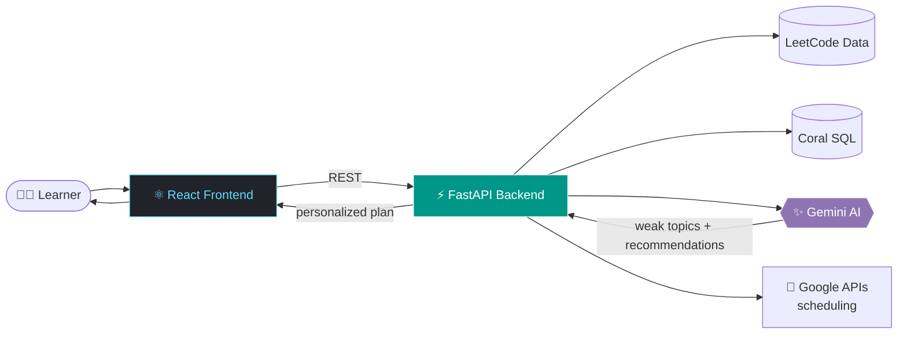

<!-- ═══════════════ HEADER ═══════════════ -->
<p align="center">
  
</p>

<p align="center">
  <a href="https://github.com/palakv07/palakv07">
    
  </a>
</p>

<p align="center">
  
  
  
</p>

---

## 🖥️ `~/palak` — terminal

```bash
palak@dev:~$ neofetch

  ┌──────────────────────────────────────────────┐
  │  👩‍💻  NAME        Palak Verma                  │
  │  🎓  DEGREE      BE · Computer Science Eng.    │
  │  ⚡  FOCUS       Full-stack AI/ML applications │
  │  🧠  LEARNING    DSA · Advanced Java · React   │
  │                  Backend · System Design       │
  │  🏆  HACKATHONS  Solo builder                  │
  │  🎯  MOTTO       Idea → Working → Deployed     │
  └──────────────────────────────────────────────┘

palak@dev:~$ _
```

---

## 🧰 Tech Arsenal

<p align="center">
  
  <br/>
  
  <br/>
  
</p>

<p align="center">
  
  
  
  
  
</p>

---

## 🚀 Featured Project — AI StudyMate

> **An AI-powered LeetCode coach** that turns random grinding into a structured, personalized study plan.

<table>
<tr>
<td width="50%" valign="top">

### ⚙️ What it does
- 📊 Tracks solved LeetCode problems
- 🔍 Detects weak DSA topics
- 🤖 AI-recommended next problems
- 📅 Schedules coding sessions
- 🔗 Integrates with productivity tools
- 📈 Progress insights

</td>
<td width="50%" valign="top">

### 🛠️ Built with


<br/>

[](https://github.com/palakv07/StudyMate)

</td>
</tr>
</table>

### 🧬 How it works (live-rendered by GitHub)



---

## 📊 Live Stats

<p align="center">
  
  
</p>

<p align="center">
  
</p>

### 🧩 LeetCode

<p align="center">
  <a href="https://leetcode.com/u/palakv_07/">
    
  </a>
</p>

### 📈 Contribution Graph

<p align="center">
  
</p>

---

## 🐍 Contribution Snake

<p align="center">
  
</p>

<p align="center"><i>Every green square is another step forward 🌱</i></p>

---

## 🎯 Currently Levelling Up

| Skill | Progress |
|---|---|
| 🧮 Data Structures & Algorithms |  |
| ☕ Advanced Java |  |
| ⚛️ React |  |
| 🏗️ System Design |  |

---

## 🌐 Let's Connect

<p align="center">
  <a href="https://portfolio-two-mu-68.vercel.app/"></a>
  <a href="https://www.linkedin.com/in/palak-verma-72b2592a4/"></a>
  <a href="https://leetcode.com/u/palakv_07/"></a>
  <a href="https://github.com/palakv07"></a>
</p>

<p align="center">
  
</p>
